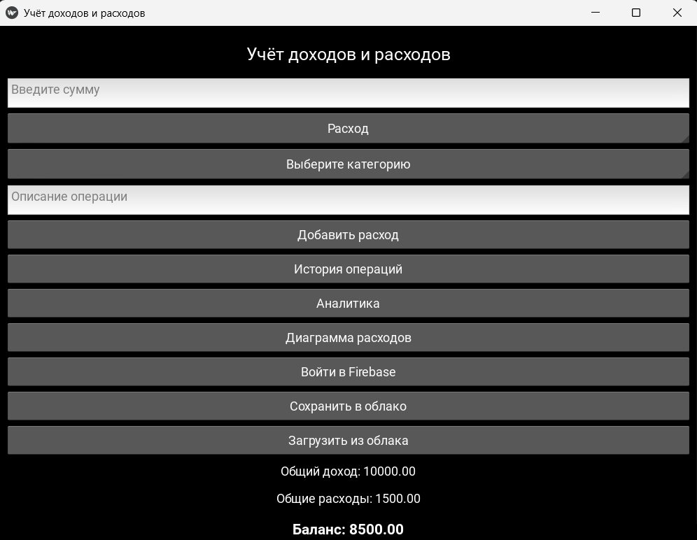
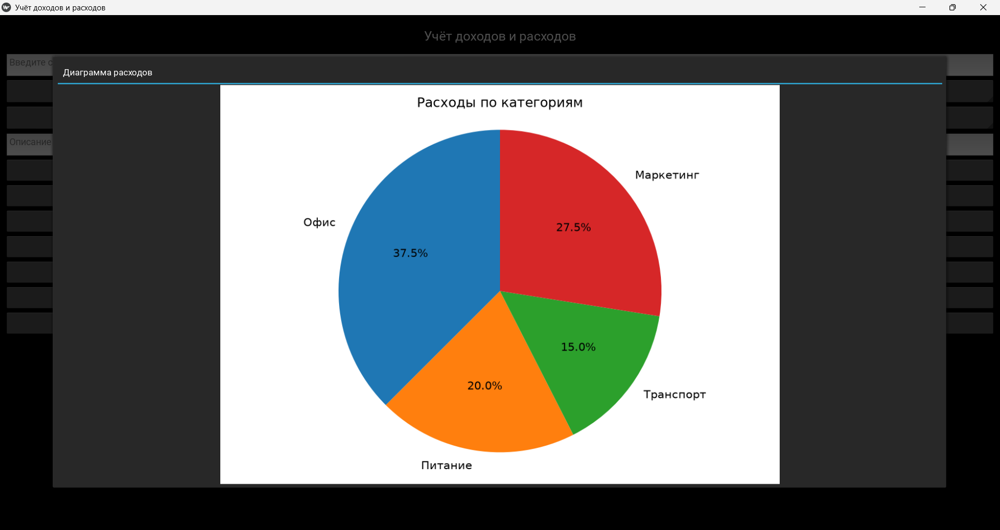
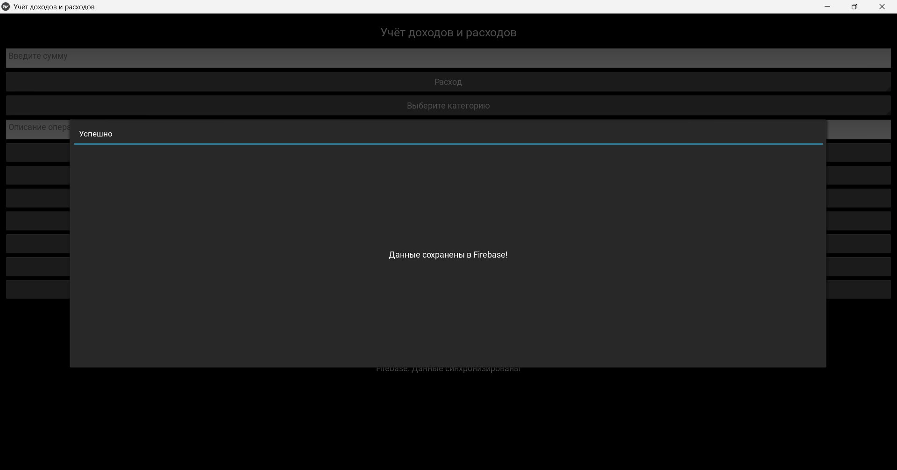
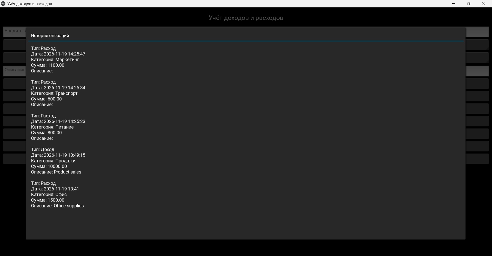
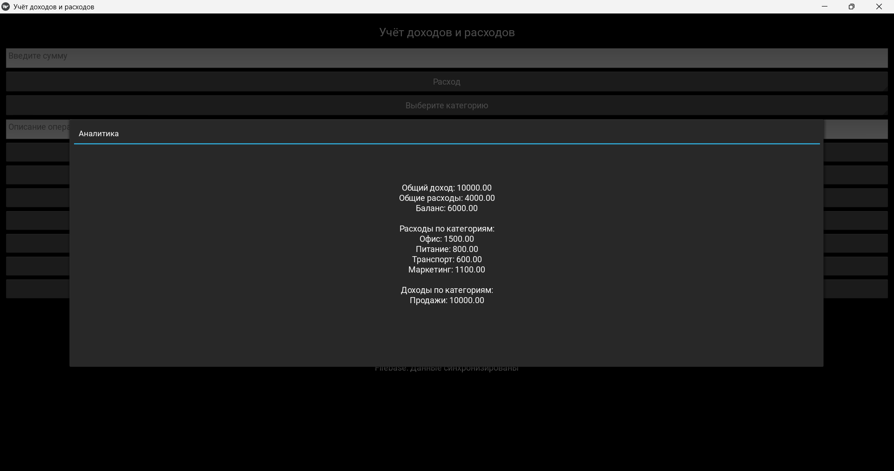

# ExpenseTracker — учёт доходов и расходов

## Описание проекта

ExpenseTracker — приложение для учёта доходов и расходов бизнеса, разработанное на языке Python с использованием библиотеки Kivy.

Приложение позволяет регистрировать финансовые операции, анализировать расходы, визуализировать данные и выполнять облачную синхронизацию с Firebase Realtime Database.

## Цель работы

Разработать приложение для учёта финансовых операций с графическим интерфейсом, локальным хранением данных, аналитикой и возможностью облачной синхронизации.

## Реализованные функции

1. Добавление доходов и расходов.
2. Выбор категории финансовой операции.
3. Указание суммы, описания и даты операции.
4. Автоматический расчёт общего дохода, расходов и баланса.
5. Просмотр истории финансовых операций.
6. Анализ доходов и расходов по категориям.
7. Построение круговой диаграммы расходов с использованием Matplotlib.
8. Локальное сохранение данных в JSON.
9. Авторизация пользователей через Firebase Authentication.
10. Сохранение и загрузка данных через Firebase Realtime Database и REST API.
11. Русскоязычный интерфейс приложения.

## Используемые технологии

- Python — язык программирования.
- Kivy — графический интерфейс.
- Matplotlib — построение диаграмм.
- Requests — выполнение HTTP-запросов.
- Firebase Authentication — авторизация пользователей.
- Firebase Realtime Database — облачное хранение данных.
- JSON — локальное хранение финансовых операций.

## Установка и запуск

### 1. Создание виртуального окружения

```powershell
py -m venv .venv
```

### 2. Активация окружения

```powershell
.\.venv\Scripts\Activate.ps1
```

### 3. Установка библиотек

```powershell
python -m pip install -r requirements.txt
```

### 4. Настройка Firebase

Создать проект Firebase, включить Email/Password Authentication и создать Realtime Database.

Скопировать файл `firebase_config.example.json` в `firebase_config.json`.

Указать собственные значения:

- `api_key` — Web API Key проекта Firebase.
- `database_url` — адрес Firebase Realtime Database.

Настроить правила доступа к данным авторизованных пользователей.

### 5. Запуск приложения

```powershell
python main.py
```

## Работа с приложением

Для добавления операции необходимо выбрать тип (доход или расход), указать сумму, категорию и описание, затем нажать кнопку добавления.

Кнопка «История операций» отображает сохранённые финансовые операции.

Кнопка «Аналитика» показывает общие суммы и распределение по категориям.

Кнопка «Диаграмма расходов» строит круговую диаграмму расходов.

Для облачной синхронизации необходимо войти через Firebase Authentication.

Кнопка «Сохранить в облако» отправляет текущие данные в Firebase, заменяя предыдущую облачную копию.

Кнопка «Загрузить из облака» загружает облачные данные вместо локальных после подтверждения.

## Скриншоты приложения

### 1. Главное окно приложения

Главное окно ExpenseTracker с русскоязычным интерфейсом, возможностью добавления финансовых операций и отображением доходов, расходов и баланса.



### 2. Диаграмма расходов

Круговая диаграмма, построенная с помощью Matplotlib, отображает распределение расходов по категориям в процентах.



### 3. Синхронизация с Firebase

Результат успешного сохранения финансовых операций в облачную базу Firebase Realtime Database.



### 4. История операций

Просмотр сохранённых доходов и расходов с указанием даты, категории, суммы и описания.



### 5. Финансовая аналитика

Анализ доходов и расходов по категориям, расчёт общих сумм и текущего баланса.




## Результат работы

Разработано приложение ExpenseTracker для учёта доходов и расходов бизнеса.

Реализованы графический интерфейс, локальное хранение данных, аналитика, визуализация расходов и ручная облачная синхронизация через Firebase REST API.

## Вывод

В ходе выполнения практической работы были изучены возможности библиотеки Kivy, реализована обработка финансовых операций, построены диаграммы с помощью Matplotlib и настроено взаимодействие с облачной базой Firebase.
